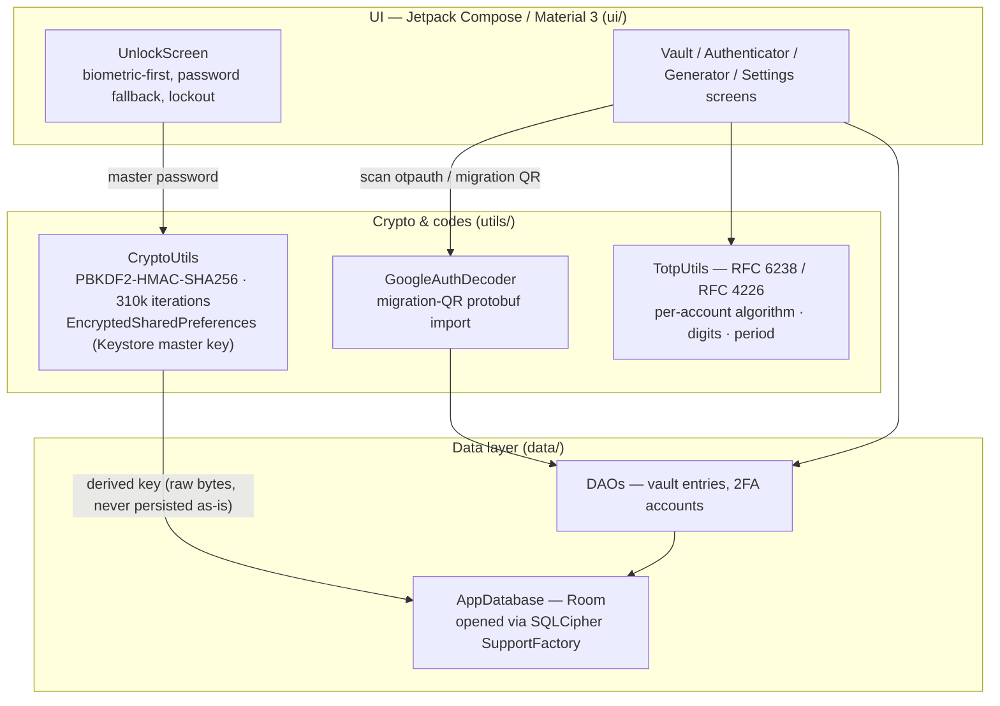

# 🔒 Z-Security — Encrypted Vault & TOTP Authenticator

**A fully offline Android vault and two-factor authenticator: passwords and TOTP secrets live in a SQLCipher-encrypted database, unlocked by a master password or biometrics — no account, no cloud, no internet permission.**

   

## Overview

Z-Security (shown on-device as **Z+ Secure**) is a shipped Android security utility with three tools in one offline app:

- **Password vault** — credentials stored in a Room database encrypted at rest with **SQLCipher**. The database key is derived from the master password with **PBKDF2-HMAC-SHA256 at 310,000 iterations** (older vaults created at the legacy 65,536-iteration cost are migrated transparently at unlock).
- **TOTP authenticator** — RFC 6238 time-based codes (and RFC 4226 HOTP) that honour each account's own **algorithm (SHA-1 / SHA-256 / SHA-512), digit count and period**, instead of assuming the defaults. Accounts are added by scanning `otpauth://` QR codes (CameraX + ML Kit / ZXing), including **Google Authenticator migration QR** imports. v1.2.0 added **authenticator search** — filter accounts by issuer or name.
- **Password generator** — create strong passwords without leaving the app.

Unlock is **biometric-first** (AndroidX Biometric) with the master password as fallback and a lockout countdown after repeated failures. Settings and secrets that live outside the database are kept in **EncryptedSharedPreferences**, whose master key (AES-256-GCM) is held by the **Android Keystore**.

The app requests **no INTERNET permission** — the only runtime permissions are Camera (QR scanning) and Biometrics. There is nothing to phone home to: no account, no sync, no analytics.

## Download

Signed release APKs are published on the [Releases](https://github.com/Manoj-2424150118/Z-Security/releases) page — latest: **[v1.2.1](https://github.com/Manoj-2424150118/Z-Security/releases/tag/v1.2.1)**. Releases from v1.1.0 onward are signed with a permanent release key, so updates install in place. Requires Android 8.0 (API 26) or newer.

> **Upgrading from v1.0.x:** those builds used one-off debug keys, so Android will refuse an in-place update. Export your vault (Vault tab → export) and note your 2FA setup keys first — the old app has no 2FA export — then uninstall and reinstall.

## Architecture

Single-module Jetpack Compose app: a Material 3 UI layer over a small data layer, with cryptography isolated in `utils`.



## Threat model

| Asset | Adversary | Mitigation |
|---|---|---|
| Vault contents & TOTP secrets at rest | Thief / finder of a lost or seized phone | Whole database encrypted with SQLCipher; key derived from the master password via PBKDF2-HMAC-SHA256 (310k iterations, per-vault salt); biometric-or-password gate with lockout on repeated failures |
| App preferences & stored settings | Other apps / casual device access | EncryptedSharedPreferences — AES-256-SIV key encryption, AES-256-GCM value encryption, master key in the Android Keystore |
| Secrets in transit | Network attacker | Not applicable by design: the app holds **no INTERNET permission** and has no network code path; nothing leaves the device |
| The master password itself | The user forgetting it | Unrecoverable **by design** — there is no account, server or reset flow that could restore access; the CSV vault export (user-initiated, **plaintext** — the app warns it must be stored privately) is the only backup path |
| Wrong TOTP codes breaking logins | Issuers using non-default parameters | Codes are generated with each account's stored algorithm, digit count and period; parse/generation failures surface as errors instead of plausible-looking fake codes |
| Malicious or trojanised builds | Supply-chain attacker | Releases signed with a permanent release key; Android refuses updates that do not match the installed signature |

## Tech stack

| Layer | Technology |
|---|---|
| Language | Kotlin |
| UI | Jetpack Compose · Material 3 · Navigation Compose |
| Storage | Room · **SQLCipher** (`sqlcipher-android`) · EncryptedSharedPreferences |
| Key derivation | PBKDF2-HMAC-SHA256, 310,000 iterations (legacy 65,536 migrated at unlock) |
| Unlock | AndroidX Biometric · master-password fallback · lockout countdown |
| QR scanning | CameraX · ML Kit Barcode Scanning · ZXing core |
| Platform | Android — minSdk 26 (Android 8.0), target/compileSdk 35 · AGP 8.5 · Gradle 8.7 |
| Current release | v1.2.1 tag (app build 1.2.0, versionCode 4) — authenticator search |

## Setup & build

1. Install **Android Studio** (JDK 17 toolchain) and clone the repository.
2. Open the project and let Gradle sync.
3. Build and test:

```bash
./gradlew assembleDebug        # debug APK
./gradlew testDebugUnitTest    # JVM unit tests
./gradlew assembleRelease      # release APK (requires the release keystore — maintainer builds)
```

End users do not need to build anything: install the signed APK from [Releases](https://github.com/Manoj-2424150118/Z-Security/releases).

## Testing

- **23 JVM unit tests** covering TOTP/HOTP generation against reference vectors, Google Authenticator migration decoding, crypto utilities, and the v1.2.0 account filter (`app/src/test/…`).
- **CI:** the Android CI workflow builds the app and runs the unit tests on every push to `main`.

## Security

Report vulnerabilities privately, per **[SECURITY.md](SECURITY.md)** — please do not open public issues for security reports. Note the honest limits of the design: security rests on the strength of the master password and the device's own lock screen; a rooted device or a compromised OS is outside the threat model, and the user-initiated CSV export is plaintext by design.

## License

MIT — see [LICENSE](LICENSE) for the full text.
